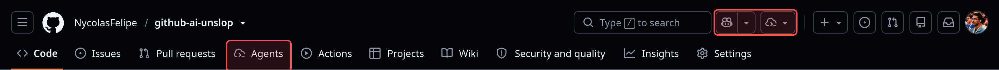
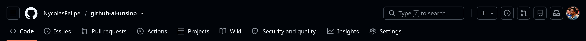
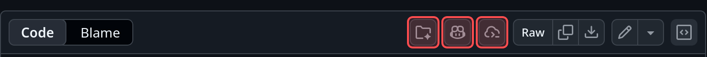
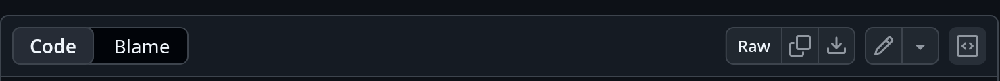
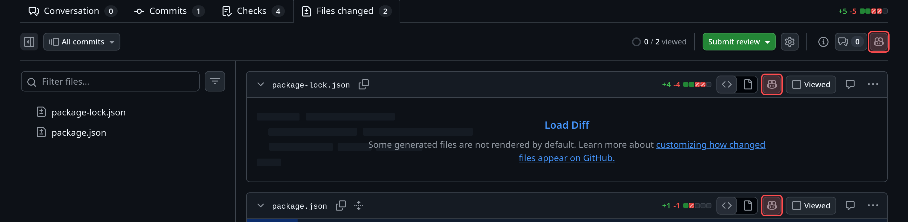
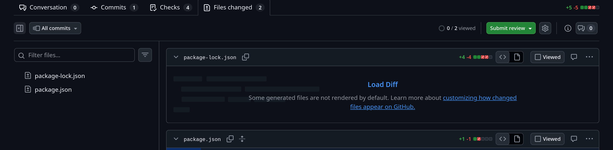
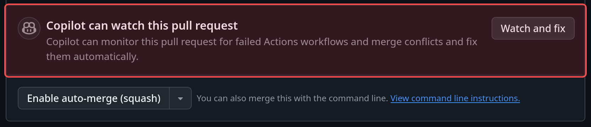
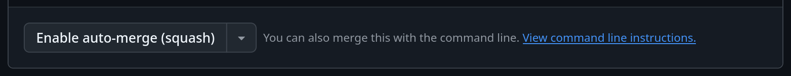

# GitHub AI Unslop

Extensão para Firefox que remove o Copilot da interface do GitHub:

- os botões do Copilot e do painel de agentes no cabeçalho;
- a aba **Agents** dos repositórios e a seção **Agent sessions** do dashboard;
- os botões do Copilot, de agentes e de "Add to space" na visualização de
  arquivos e na aba **Files changed** dos pull requests;
- a seção "Copilot can watch this pull request", com o botão **Watch and fix**,
  na caixa de merge dos pull requests;
- links para `/copilot`, opções como "Assign to Copilot", banners do Copilot e
  elementos `<copilot-*>`.

As páginas de configuração (`/settings/copilot`) continuam acessíveis, para que
você ainda consiga desligar recursos do Copilot na conta.

## Antes e depois

Os elementos destacados em vermelho são os que a extensão remove.

**Cabeçalho e navegação do repositório**




**Visualização de arquivo**




**Pull request, aba Files changed**




**Pull request, caixa de merge**




## Como funciona

`content.js` roda em `github.com` e `gist.github.com` desde o início do
carregamento e faz duas coisas:

1. Injeta uma folha de estilo que esconde elementos com marcadores estáveis do
   Copilot (`partial-name`, `data-testid`, `aria-label`, links para
   `/copilot` etc.).
2. Observa o DOM com um `MutationObserver` e esconde botões e itens de menu
   cujo texto menciona "Copilot", ignorando conteúdo escrito por usuários
   (markdown, comentários, código).

O GitHub muda a interface com frequência. Quando algo novo do Copilot
aparecer, adicione o seletor na lista `SELECTORS` em `content.js`.

## Testes

Os testes rodam o `content.js` num Firefox de verdade, sobre uma página que
reproduz o HTML do GitHub ([tests/fixtures/github.html](tests/fixtures/github.html)).
Cada elemento da página está marcado com `data-expect="hidden"` ou
`data-expect="visible"`, e os testes conferem os dois lados. Também cobrem
conteúdo carregado depois da página, a navegação do Turbo e o liga/desliga.

```sh
npm install
npm test
```

O Firefox é procurado no `PATH`. Para usar outro, defina `FIREFOX_BIN`.

Quando o GitHub mudar a interface, adicione o novo elemento à página de teste
com `data-expect="hidden"` antes de mexer nos seletores. O GitHub Actions roda
o lint e os testes a cada push.

## Instalar para testar

1. Abra `about:debugging#/runtime/this-firefox`.
2. Clique em **Carregar extensão temporária** e escolha o `manifest.json`.

Ou, com o [web-ext](https://github.com/mozilla/web-ext):

```sh
npx web-ext run
```

## Empacotar

```sh
npx web-ext build
```

Para instalar de forma permanente no Firefox normal, a extensão precisa ser
assinada pela Mozilla (`npx web-ext sign`, com credenciais do AMO). No Firefox
Developer Edition ou Nightly dá para desativar `xpinstall.signatures.required`
em `about:config` e instalar o `.zip` gerado.

## Ligar e desligar

Clique no ícone da extensão e use a caixa de seleção. A mudança vale na hora
para todas as abas.

## Créditos

O robô do ícone é o `copilot` do [Primer Octicons](https://github.com/primer/octicons),
© GitHub Inc., distribuído sob a licença MIT.
